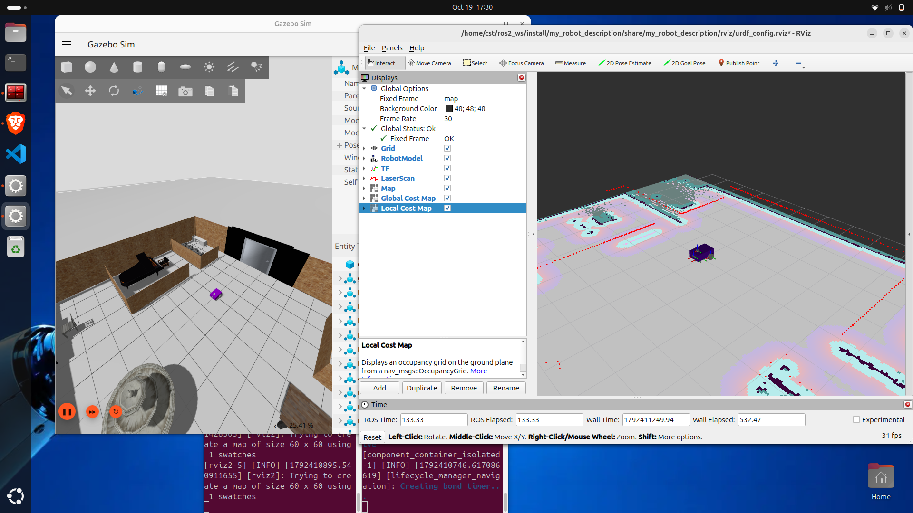

# Differential-drive robot: SLAM + Nav2 in Gazebo

ROS 2 Jazzy + Gazebo Harmonic. Custom robot with lidar and camera, mapping with SLAM Toolbox, autonomous navigation with Nav2.

## Robot Simulation

## Dependencies
sudo apt install ros-jazzy-navigation2 ros-jazzy-nav2-bringup ros-jazzy-slam-toolbox ros-jazzy-ros-gz ros-jazzy-teleop-twist-keyboard

## Build
cd ~/ros2_ws && colcon build --symlink-install && source install/setup.bash

## Run
ros2 launch my_robot_bringup my_robot_gazebo.launch.xml
ros2 launch nav2_bringup bringup_launch.py map:=$HOME/ros2_ws/src/my_robot_bringup/maps/test_1.yaml use_sim_time:=True params_file:=$HOME/ros2_ws/src/my_robot_bringup/config/nav2_params.yaml
